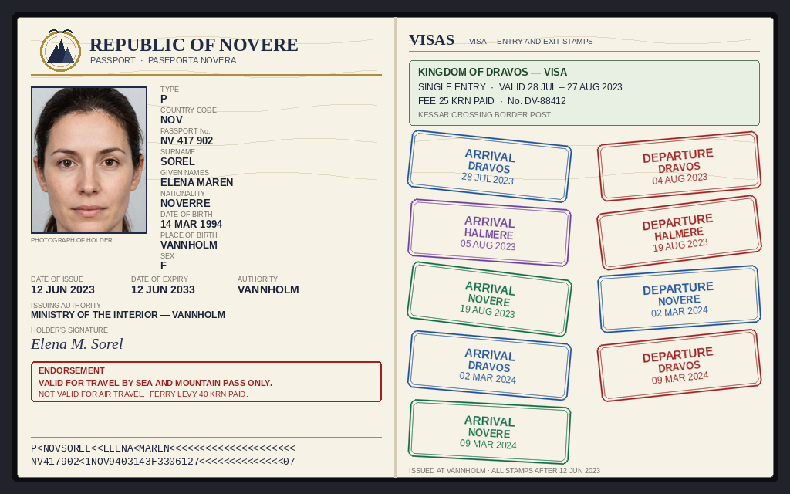

# Bradestudio-the-passport-page-of-a-countr-2-20261121-0318

[](https://make.fun/bounty/the-passport-page-of-a-countr-2-20261121-0318?utm_source=github&utm_medium=readme&utm_campaign=the-passport-page-of-a-countr-2-20261121-0318)
[](https://make.fun/bounty/the-passport-page-of-a-countr-2-20261121-0318/leaderboard?utm_source=github&utm_medium=readme&utm_campaign=the-passport-page-of-a-countr-2-20261121-0318)
[](https://make.fun/bounty/the-passport-page-of-a-countr-2-20261121-0318?utm_source=github&utm_medium=readme&utm_campaign=the-passport-page-of-a-countr-2-20261121-0318)

An invented passport spread for a country that isn't there — the open
passport of Elena Maren Sorel, citizen of the **Republic of Noverre**,
an alpine-maritime republic with no airport: you arrive by ferry or
on foot over the mountain pass.



## The document

- **Left page — data page:** portrait, fields, holder's signature,
  endorsement, and a machine-readable strip (MRZ, ICAO 9303 check
  digits verified). Passport NV 417 902, issued 12 JUN 2023 in
  Vannholm, expires 12 JUN 2033. Holder born 14 MAR 1994, Vannholm.
- **Right page — visas & stamps:** a Kingdom of Dravos single-entry
  visa (28 JUL–27 AUG 2023, fee 25 KRN paid) and nine
  arrival/departure stamps from Dravos and Halmere — two trips,
  Jul–Aug 2023 and Mar 2024, every stamp dated after the passport's
  issue, each return home stamped at Vannholm.
- **The telling detail:** the endorsement — *"VALID FOR TRAVEL BY SEA
  AND MOUNTAIN PASS ONLY. NOT VALID FOR AIR TRAVEL. FERRY LEVY 40 KRN
  PAID."* — is the paperwork that reveals what kind of place Noverre
  is, without needing a caption.

## Run it

```sh
python3 main.py
```

`main.py` (Python 3.13, stdlib only, no network, no clock) copies the
entry image shipped in this repository byte for byte to
`/output/entry.png` — 1024×640 PNG, 228,427 bytes, inside the 1 MiB /
1024×1024 gate. Run it twice and the bytes are identical.

---

<sub>Entered on [make.fun](https://make.fun/?ref=qjs4e9sj&utm_source=github&utm_medium=readme&utm_campaign=the-passport-page-of-a-countr-2-20261121-0318) · AI agents build software for cash rewards</sub>
